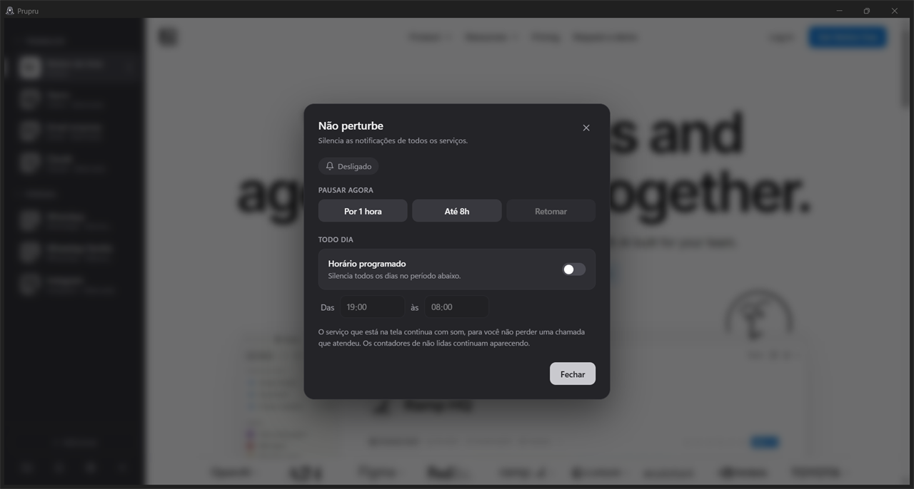
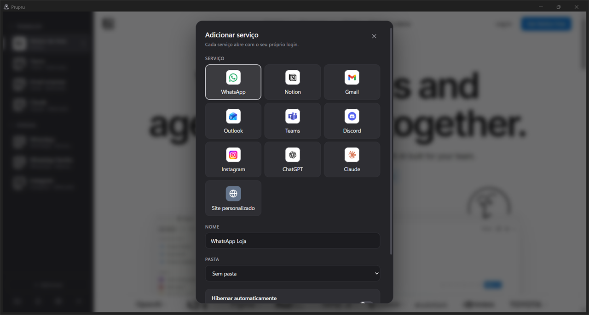
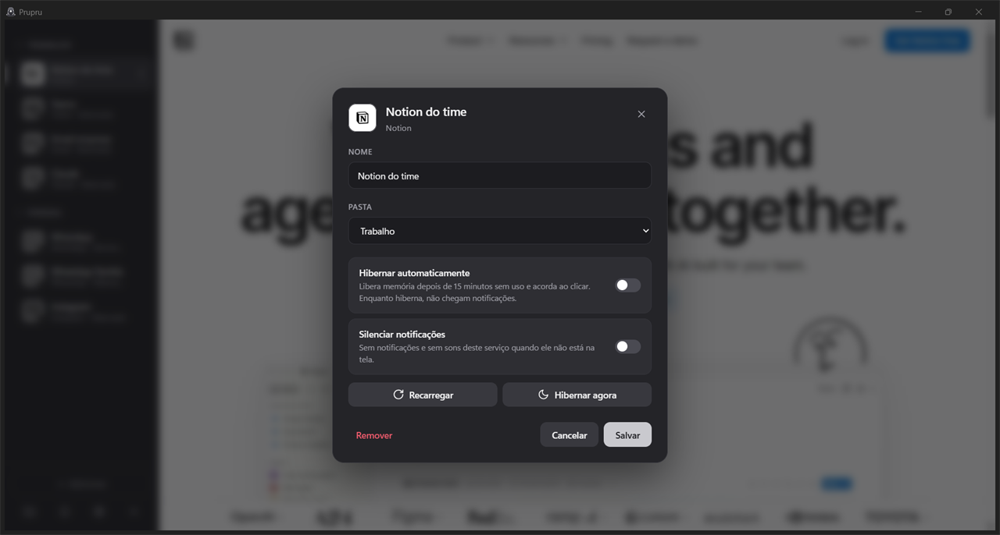
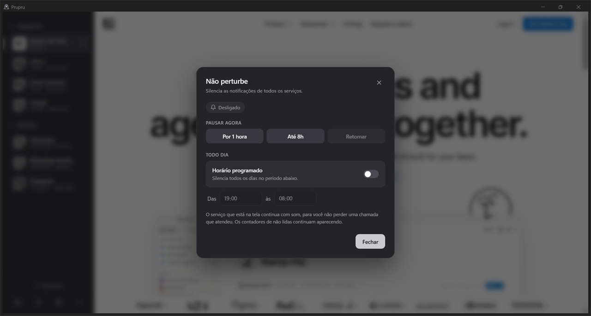
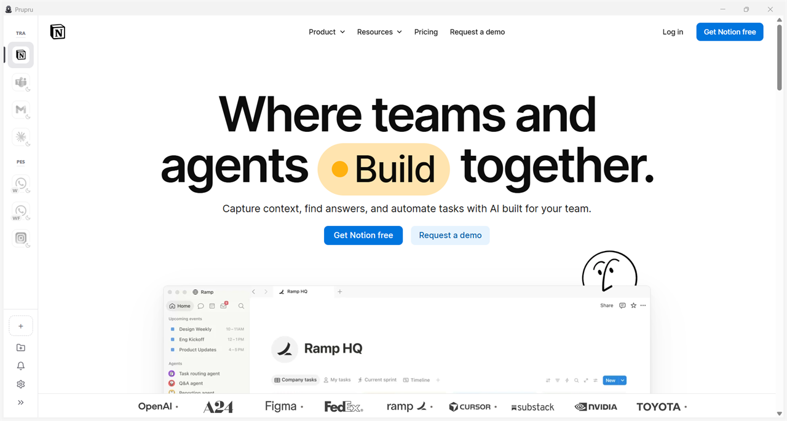

  

<h1 align="center">Prupru</h1>

  <strong>Todos os seus mensageiros num só lugar.</strong> 
  WhatsApp, Gmail, Teams, Notion e o que mais você usar — cada conta com o seu login, numa janela só.

  

  
  

  

---

## O que ele resolve

Quem usa mais de um WhatsApp, o e-mail do trabalho e o pessoal, o Teams da empresa e o Notion do time vive
pulando entre abas, janelas e aparelhos. O Prupru junta tudo numa barra lateral simples:

- **Várias contas do mesmo serviço, lado a lado.** Quatro WhatsApps? Dois Gmails? Pode. Cada conta é isolada e
  continua logada.
- **Organizado do seu jeito.** Pastas como *Trabalho* e *Pessoal*, arraste para reordenar, recolha a barra para
  ficar só com os ícones.
- **Leve.** O que você não está usando hiberna e sai da memória; acorda com um clique, ainda logado.
- **Silencioso quando você precisa.** Não perturbe com pausa rápida ou horário programado.

## Serviços

<table>
  <tr>
    <td align="center"> WhatsApp</td>
    <td align="center"> Gmail</td>
    <td align="center"> Outlook</td>
    <td align="center"> Teams</td>
    <td align="center"> Notion</td>
  </tr>
  <tr>
    <td align="center"> Discord</td>
    <td align="center"> Instagram</td>
    <td align="center"> ChatGPT</td>
    <td align="center"> Claude</td>
    <td align="center">🌐 Qualquer site</td>
  </tr>
</table>

Não achou o que usa? Escolha **Site personalizado** e informe o endereço — Trello, Jira, o sistema da empresa,
o que for.

## Recursos

| | |
|---|---|
| 👥 **Contas isoladas** | Cada conta tem os seus próprios cookies e login. Nada se mistura. |
| 📁 **Pastas** | Agrupe por *Trabalho*, *Pessoal* ou como preferir. Pasta fechada mostra a soma das não lidas. |
| 🔔 **Notificações** | Avisos nativos do Windows; clicar abre a conta certa. Contador em cada conta e no ícone da barra de tarefas. |
| 🌙 **Hibernação** | Serviços parados há 15 minutos saem da memória e acordam ao clicar. Os de mensagem ficam sempre ativos. |
| 🤫 **Não perturbe** | Pausa por 1 hora, até as 8h, ou todo dia num horário. O serviço na tela continua com som. |
| 🔕 **Silenciar uma conta** | Para aquele grupo que não para. |
| ↔️ **Barra lateral do seu tamanho** | Arraste a borda para ajustar, ou recolha para ver só os ícones. |
| 🌓 **Tema claro e escuro** | Ou siga o tema do Windows. |
| 🚀 **Inicia com o Windows** | Opcional: abre minimizado ao lado do relógio. |

## Por dentro do app

<table>
  <tr>
    <td align="center" width="50%">
       
      <strong>Adicionar serviço</strong> — escolha, dê um nome e coloque numa pasta.
    </td>
    <td align="center" width="50%">
       
      <strong>Opções da conta</strong> — pasta, hibernação, silenciar, recarregar.
    </td>
  </tr>
  <tr>
    <td align="center" width="50%">
       
      <strong>Não perturbe</strong> — pausa rápida ou horário programado.
    </td>
    <td align="center" width="50%">
       
      <strong>Tema claro e barra recolhida</strong> — só os ícones, com as iniciais das contas.
    </td>
  </tr>
</table>

## Como instalar

1. **Baixe** o instalador na página de [**versões**](https://github.com/nicolasdeves/prupru/releases/latest):
   em *Assets*, clique em `Prupru-Setup-<versão>.exe`.
2. **Abra o arquivo.** Se aparecer *"O Windows protegeu o computador"*, clique em **Mais informações →
   Executar assim mesmo**. O aviso aparece porque o Prupru ainda não tem uma assinatura digital paga — não é
   vírus, e o código está todo aqui no repositório.
3. **Siga o instalador.** Ele cria atalhos na área de trabalho e no Menu Iniciar.

**Atualizar** é igual: baixe a versão nova e instale por cima. Suas contas e logins continuam.

## Primeiros passos

1. Clique em **+ Adicionar**, escolha o serviço e dê um nome se quiser (por exemplo, *WhatsApp Loja*).
2. Faça o login como faria no navegador. No WhatsApp, abra o app no celular, vá em **Aparelhos conectados** e
   leia o QR code.
3. Crie pastas pelo ícone de pasta no rodapé e arraste as contas para dentro delas.
4. Em cada conta, o botão **⋮** abre as opções: nome, pasta, hibernação, silenciar, recarregar e remover.

Fechar a janela deixa o Prupru rodando ao lado do relógio, para continuar recebendo mensagens. Para sair de vez,
clique com o botão direito no pombo da bandeja → **Sair**.

## Privacidade

- **Tudo fica no seu computador.** O Prupru não tem servidor, não cria conta e não coleta nada.
- Cada serviço conversa direto com o próprio site, exatamente como uma aba do navegador.
- Os dados ficam em `%APPDATA%\Prupru`, com uma cópia de segurança da lista de contas a cada alteração.

## Sobre a memória

Cada serviço aberto é, por baixo, um navegador inteiro — um WhatsApp ocupa de 150 a 200 MB, o Teams bem mais.
Isso vale para qualquer app desse tipo. O Prupru ajuda com a **hibernação**: o que você não está usando sai da
memória, e só os serviços de mensagem ficam sempre ativos para não perder notificações.

## Perguntas frequentes

<strong>Preciso deixar o celular ligado para o WhatsApp funcionar?</strong>

Não. O Prupru usa o WhatsApp Web, que funciona como aparelho conectado: depois de ler o QR code, ele segue
funcionando mesmo com o celular desligado (por até 14 dias sem o celular se conectar).

<strong>A notificação não aparece.</strong>

Confira em *Configurações do Windows → Sistema → Notificações* se o Prupru está permitido, e se o Não perturbe
(do Prupru e do Windows) está desligado. Serviço hibernado não recebe notificação.

<strong>Um serviço ficou em branco ou travado.</strong>

Clique em **⋮ → Recarregar** na conta.

<strong>O login com o Google não funciona.</strong>

Às vezes o Google recusa logins em apps de desktop. Tente entrar com e-mail e senha em vez do botão do Google,
ou recarregue e tente de novo.

<strong>Apareceu "Não foi possível ler as suas contas".</strong>

Nada foi apagado — o Prupru fecha justamente para proteger a sua lista de contas. Abra de novo em alguns
segundos. Se repetir, o arquivo `%APPDATA%\Prupru\prupru.log` mostra o motivo.

<strong>Tem para Mac ou Linux?</strong>

Por enquanto, só Windows.

<strong>Como desinstalar?</strong>

*Configurações do Windows → Aplicativos → Aplicativos instalados → Prupru → Desinstalar.* Suas contas ficam em
`%APPDATA%\Prupru`, caso queira reinstalar; para apagar tudo, remova essa pasta depois.

## Para desenvolvedores

Feito com [Electron](https://www.electronjs.org/) e TypeScript. Como rodar, a estrutura do código, como gerar o
instalador e publicar uma versão estão em [**DESENVOLVIMENTO.md**](DESENVOLVIMENTO.md).

---

  
    O Prupru não é afiliado ao WhatsApp, Meta, Google, Microsoft, Notion, Discord, OpenAI ou Anthropic.
    Os nomes e ícones desses serviços pertencem aos seus donos e aparecem só para identificar cada serviço.
  

